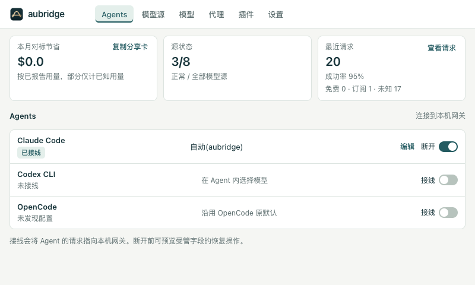

# aubridge 桌面 UI 改版定稿

日期：2026-11-12。设计：Astra。状态：已实现，UI 范围验收通过；实际命令与边界见 [验收记录](ui-redesign-acceptance-2026-11-12.md)。

这是独立的用户 UI 任务。仅调整六页的信息层级、布局、样式和呈现文案；现有源、路由、凭据、接线、请求状态和后端接口不变，不新增依赖。默认窗口 800×480，最小 760×480，不最大化、不扩大窗口。0097 的 BLOCKED、累计 4 / 10 不因本方案或 UI 完成而改变。

## 1. 当前界面的主要问题

基于 `crates/smoke/web/src/` 当前实现，而非旧设计假设：

- `App.tsx` 的错误在页面末尾，操作失败可能发生在视口外；六页标题有中英文混用，选中样式弱。
- `style.css` 几乎所有按钮都采用蓝色填充，主动作、检测、编辑、清除竞争注意力；全黑背景、蓝灰辅助字和密集裸表格缺少层次。
- `Agents.tsx` 三张摘要使用 flex/min-width，卡内长文容易增高；五列表把同一次接线拆成开关、名字、模型、状态、动作，命令提示挤入操作列。加载中的健康数可能显示为 0/0，源数据未到时不能据此宣称源就绪。
- `Providers.tsx` 五列表同时放完整模型列表、Key 输入、检测模型、暂停、编辑和删除；用户难以先判断哪个源需要处理。凭据就绪、路由资格、一次检测结果是三种不同状态，不能合成“可用”。
- `Proxy.tsx` 七列表默认展示全部尝试轨迹、token 和六个筛选输入；网关状态、端点和管理令牌三个大卡挤占请求空间。用户最关心的“哪次请求用了订阅、详情是什么”反而难扫读。
- 模型、插件和设置仍需要保留已有高级能力，但页面说明包含 `§7`、原子写等内部实现文字，不帮助日常判断。

## 2. 官方参考与取舍

本次浏览官方页面的产品演示 DOM、图示文字与操作标签；不据营销描述推断软件实际能力，也不声称进行了这些产品的原生运行验证。

| 官方来源 | 页面实际展示的 UI 特征 | 本次采用的原则 |
|---|---|---|
| [Granola](https://www.granola.ai/) | 首页笔记演示把会议标题、正文、转写/增强中的状态、生成笔记动作分层；原始/增强结果有切换标签 | 工作对象优先、状态短而明确；只在当前工作旁给下一步动作，不加欢迎大横幅 |
| [Superwhisper](https://superwhisper.com/) | Modes 演示中，模式名称与预设在前，Language Models/Voice Models 位于 Advanced settings 区域，模型通过选择控件呈现 | 先完成日常任务，凭据、接入参数、模型全目录按需展开；不照搬其模式或模型功能 |
| [MacWhisper](https://www.macwhisper.com/) | 首页演示出现“Zoom Meeting Detected”与单一 Record 动作的短提示 | 引导卡只解释一个当前阻碍并给一个下一步；不引入会议检测、录音或悬浮窗 |

不采用官网的大 Hero、大标题、营销渐变、巨大卡片或持续动画。颜色和几何来自 aubridge 自身 `brand-design.md`，不从参考产品推导。

## 3. 框架与视觉规范

### 3.1 顶部和滚动

- 保留横向六页，顺序：**Agents / 模型源 / 模型 / 代理 / 插件 / 设置**。保留内部 tab key，不变更数据合同。
- 顶部 `.app-header` 高 48px，左右 16px，品牌图标 24px 与文字相隔 7px；品牌宽约 128px。品牌只出现一次，使用现有 `app-icon.svg`。
- `.app-nav` 单行 flex，gap 2px；导航按钮高 30px，左右 10px，13px/500。选中项浅青底、青墨字，2px 内侧下边线或轻边框；不可仅以字色辨别。
- 800px 窗宽内容净宽 768px；760px 净宽 728px。`main` 左右 16px，上下 12px；`min-width:0`。不为实现布局修改 Tauri 尺寸。
- `html/body/#root` 高度使用实际视口；壳为纵向 flex，header 不滚动，main `flex:1; min-height:0; overflow-y:auto`。正常页面不出现整个窗口的水平滚动；局部确有长表时 `.table-scroll` 自行横滚。
- 不增加固定底栏、不增加空的页头 Hero。页级 `.page-heading` 高约 30px，左侧 16px/600 标题，右侧一个主动作；Agents 摘要本身即页头，不重复大标题。
- 全局错误移至 header 后/主区前，`.alert.error`，可关闭，`role=alert`，保留现有可恢复原因。长错误可展开或在有限高度内滚动，不能遮住页面全部空间。不得引入宽泛错误白名单、静默净化或把具体原因统改成“失败”。原始凭据不新增到任何输出。异步错误归属沿现有流程，不因简单切页自动抹掉尚未处理的失败。
- 壳不添加虚构“运行中”状态；运行状态只来自已有 Gateway 数据。Agents 的源健康也不能替代网关状态。

### 3.2 色彩、字形与尺寸

本轮使用统一浅色桌面界面；不新增主题开关或第二套主题。

| Token | 值 | 用途 |
|---|---|---|
| `--bg` | `#F5F6F3` | 主背景，微暖浅灰 |
| `--surface` | `#FFFFFF` | 内容行、弹层 |
| `--surface-soft` | `#EDF2F0` | 次级分区/展开区域 |
| `--ink` | `#17343A` | 主文字、主按钮 |
| `--muted` | `#5E6F70` | 可读辅助文字，不再用低对比蓝灰 |
| `--line` | `#DCE4E0` | 1px 分隔线 |
| `--accent` | `#245B61` | 链接、选中、焦点、开关 |
| `--accent-soft` | `#E4EFEB` | 选中底、就绪底 |
| `--gold-soft` | `#F6EBD6` | 订阅类别的轻提示 |
| `--gold-ink` | `#785B2F` | 订阅标签文字 |
| `--danger` / `--danger-soft` | `#A13936` / `#FBEDEB` | 真实失败与危险确认 |
| `--warning` / `--warning-soft` | `#8A6126` / `#FBF1DD` | 暂停、需关注、不可用 |

- 字体系统栈 `-apple-system, BlinkMacSystemFont, "Segoe UI", sans-serif`；代码用系统等宽。正文 13px/1.45；辅助 12px/1.4；标签 11px；页标题 16px/600；摘要数字 21px/600。正文不可小于 12px。
- 间距只用 4/8/12/16/20/24px；常规行内 gap 8px。行容器圆角 8px，按钮/输入 6px，弹层 12px。仅弹层有柔和阴影；列表主要用分隔线，不给每项重阴影。
- 常规按钮和输入 30px 高；紧凑行按钮最小 28px。`.button-primary` 青墨实底白字；默认 button 与 `.button-secondary` 白底细线；`.ghost`/`.copy` 透明轻按钮；`.button-danger` 只在确认或明确删除处使用红字。每页/弹层同一区域最多一个实心主动作。
- 所有交互保留 `:focus-visible` 2px 青色描边与 2px offset。禁用状态明确；`prefers-reduced-motion` 时无过渡。无需新图标依赖；必要的小图标采用同一 16px、1.6px 线宽内联 SVG，装饰图标 `aria-hidden`。按钮必须有可读文字或准确 accessible name，不以 emoji 作状态。
- `.badge` 为中性基础；`.badge.success` / `.warn` / `.bad` / `.off` / `.subscription` 各有语义。文字始终说明状态，不用颜色单独表达。

### 3.3 共用 class 合同

壳 owner 在 `style.css` 集中实现，页面 owner 只加 markup/class，不写全局 CSS：

`app-shell app-header app-nav app-main page-heading page-title page-description toolbar actions panel panel-header panel-body section-label summary-grid summary-card summary-label summary-value summary-note status-line data-list data-row row-main row-title row-meta row-actions detail-panel empty-state alert error button-primary button-secondary button-danger table-scroll modal-header modal-body modal-actions field field-grid`。

保留现有 `.row .card .cards .guide .badge .muted .hint .copy .ghost .switch .add-form .invalid .modal-backdrop .modal .route-preview` 的可兼容基础样式；页面特化使用 `.agents-page .agent-row .providers-page .provider-row .proxy-page .request-row .models-page .settings-page .plugins-page`。未列出的必要 class 由页面 owner 通知壳 owner 补齐，不互写 CSS。

并行实施已协调的命名优先使用下列等价合同，避免为统一拼写返工：主/危险按钮用 `btn-primary` / `btn-danger`，分区标题 `panel-heading`，详情 `section-details`，动作组 `button-row`，字段网格 `form-grid`，状态 `status-empty` / `status-loading`。Agents 用 `agents-summary`、`metric-label/value/note/action`、`section-head`、`agent-list/item/identity/model/actions/hint`；Proxy 用 `gateway-strip`、`request-list/item/summary/detail`；模型源用 `source-list/card/heading/summary/details`。这些名称分别对应上面的摘要、数据行和详情语义；无需同时添加两套class，也无需创建新组件库。

## 4. 六页具体布局

### 4.1 Agents：日常工作台

默认从上到下：三项摘要 → 有阻碍时的一条下一步提示 → Agent 列表 → 一行接线说明。

- `.summary-grid` 固定三列 `repeat(3,minmax(0,1fr))`，gap 10px，不随760/800换成多行。常态摘要约64px高，内部12px padding：本月对标节省、源状态、最近请求。分享卡改轻按钮；金额用独立数字，原“按已报告用量/部分仅计已知部分”说明可用短行或展开口径，但不得删掉对标含义。
- 源状态加载显示“读取中”，失败显示“暂不可用”，成功才显示 healthy/total；0个源是已读取的真实零。最近请求同样区分加载、读取失败、无记录；免费/订阅/未知统计只按原来的严格选中尝试判定，不能拿当前源类别补历史。
- 来源拆分可在摘要下方紧凑次行呈现“免费 N · 订阅 N · 未知 N”。加“查看请求”跳代理页，使用已有 `go`，不新增 API。
- 引导只给一个最高优先步骤：凭据未就绪 → “先设置一个模型源”/“设置模型源”；已就绪源全部暂停 → “恢复一个模型源”；源数据确实就绪且没有接线 → “在下方接线一个 Agent”。数据未读取时不展示误导性就绪结论。不新增 Agent 添加能力。
- Agent 列表替代5列裸表：每行主体 grid 为 `minmax(145px,1fr) minmax(150px,1.2fr) auto`，gap12px；第一块名称+明确接线状态，第二块所选模型，右侧编辑/同步/现有开关。名称13px/600，次行12px。正常行44–48px高；长命令或异常可自然增高。
- “在位”改“已接线”；保留未安装、未发现配置、协议待接通、第三方改写、端口变更等区别。OpenCode原默认不能显示成自动；Codex启动命令在该行次级提示内完整可见/可换行，不挤窄主操作。
- 列表四个常见 Agent 常态目标在480高内看到；引导、长错误或扩展内容存在时允许主区纵向滚动，绝不为“一屏”藏状态或压小字。
- 编辑与断开预览仍使用原 handler/禁用条件。Agent token 默认遮蔽，可主动显示/复制（关闭后重置）；已存在的阻塞恢复预览不可省略。模型选择、OpenCode同步、恢复字段列表一项不删。

### 4.2 模型源：先看状态，再展开配置

- 顶部标题“模型源”，说明“官方免费档优先，自有订阅兜底”，右侧实心“添加模型源”。保留现有 AddForm，移到列表前的 panel；取消/收起可到达，类别仍必须显式选择，不预选。
- 五列表改 `.data-list`。每个源第一行：源名/ID + 免费档或自有订阅标签 + 凭据状态 + 右侧“管理”。次行摘要“X个模型”及暂停、上游停用等真实警示；严重状态不藏在折叠内。
- `details` 展开区分三组：**凭据**（原 KeyForm，password 输入，保存/清除及环境变量说明）、**连接检测**（原模型选择/检测结果、明确会发一条请求的说明）、**模型与路由**（完整模型名单、RoutingStatus、逐模型免费状态/冷却）。每一组有小标题，不再横向塞在一个td。
- 暂停/恢复为次按钮；上游停用时“重新允许路由”及原解释保留；自定义源编辑、删除保留，删除移到展开区末尾的危险动作行，现确认流程不变。
- 凭据就绪不写成“连接正常”；检测回执不替代路由状态；目录声明不当作可推理/免费额度保证。失败、环境 Key 回退、迟到检测忽略等逻辑原样保留。
- OpenRouter免费目录、更新时间/旧目录回退/刷新失败、USD预算及未知状态移到独立紧凑panel，默认可折叠详情，刷新按钮可达。模型编辑器的目录搜索、勾选、最多100项、显式加入草稿/保存及地址限制完整保留。
- 页尾“已检测的 Agents”替代“可反代的 Agents”；保持原全局检测/接线计数，不编造每个源专属服务 Agent 数量。

### 4.3 代理：运行状态与可读请求记录

- 首行 `.status-line`：文字“网关运行中”或“新请求已暂停”，旁边“暂停新请求”/“恢复新请求”。说明“暂停后不再接收新推理，已进入的请求继续完成”，不把软开关叫退出应用。保留当前 serving 事件优先、迟到回执保护和同步失败提示。
- 接入地址与管理令牌合入默认收起 `details`，summary“手动接入与管理令牌”。展开保留地址复制、令牌遮蔽/显示/复制、仅本机回环说明；重新进页遮蔽，不能把管理令牌当Agent token。
- 历史标题同一行：历史请求 / 筛选 / 刷新 / 次级清空。筛选折叠时显示“已筛选”及条件数；所有六条件仍存在：客户端ID、选中源ID、涉及源ID、模型ID、类别、结果。展开用3列 `.field-grid`（每格minmax(0,1fr)），2行+动作，两个窗口宽度均可容纳。重置仍清除查询，分页和事件同步不重置用户筛选。
- 七列表改请求列表，每条紧凑 `details.request-row`。summary 主行展示模型（必要时请求→实际）、结果文字、选中源/类别、短时间；次行客户端与总耗时。右侧小文字“详情”，不得依赖无标题箭头。
- 展开区显示完整时间、首段/总耗时、输入/输出 token、按顺序尝试和跳过的候选、命中标记、每次耗时、原因、重试时刻、上下文估算、复制诊断。所有字段来自原 `projectTrace`，保留 legacy字符串与“轨迹暂不可用”。
- 成功订阅行可用浅金“订阅”标签和“查看路由原因”提示，不直接宣称“免费额度用完”。展开按事实列出尝试/跳过原因；若记录不足，明确“此记录未提供完整原因”。只有可靠选中历史尝试才展示类别，未知不可猜测；用户可以从全记录确认为什么用订阅。
- 失败/无候选保留“检查模型源”跳转；取消用中性状态，不能归为上游失败。未知token/时间显示“—”或“未知”，不显示0。
- 加载失败、分页失败保留重试入口和已加载行，空筛选结果与历史不可读取分开。清空确认范围与用量继续累计提示原样保留；确认按钮红色，默认焦点取消。

### 4.4 模型：清楚呈现规则和成员

- 顶部“模型”+“新建分组”；内置自动项为一行浅底panel，说明免费优先与订阅兜底，保留不可删标记。
- 已有分组可以保持紧凑表或改列表，但每行只突出对外名称、规则、成员摘要、编辑/预览；完整成员用换行/展开，保留原顺序。删除为次级危险操作。
- 固定四规则、仅免费提醒、失去目录的成员、上下移动、取消草稿全部保留。编辑区域统一panel/field-grid，长模型清单可局部滚动，保存按钮可到达。
- 路由预览继续使用原只读API，普通文本/工具调用切换、网关暂停提示、候选和跳过原因全部保留；不可因视觉改版自动发起真实模型请求。

### 4.5 插件：明确高级范围

- 标题“插件”，一行说明“扩展模型源，默认关闭”。自动开启新插件作为独立设置行，保留原开关默认与行为。
- 插件列表保留启用、ID、版本、类别、模型；模型长名折行，不扩大窗口。空态提供已有目录说明，不新增安装/市场入口。
- 插件目录放“本机插件目录”details；校验失败摘要必须默认可见，错误内容可展开/滚动。不能隐藏数量、失败文件或可恢复原因。

### 4.6 设置：清楚解释共享登录

- 标题“设置”；“与 CLI 共享登录”独立panel，开关与当前开/关同一行，说明“默认只读取登录信息；开启后会将刷新后的登录凭据写回 CLI，并保留开启前备份”。去掉面向用户的 `§7`、字段合并/原子写实现说明。
- 风险文字保持可见。备份作为次级panel显示有无、备份时间、恢复按钮；hash和存储路径可在“备份详情”展开中保留。存储未接线必须可见、继续禁用相关动作。
- 原恢复行为、禁用/等待、回执刷新不改；不新增一个假的恢复预览API。现有“还原备份”保留清楚作用，已有恢复预览/确认在哪些流程存在就在哪些流程完整保留。

## 5. 弹层、键盘与小窗

- 通用backdrop固定inset0，padding16px；普通modal宽 `min(520px,calc(100vw - 32px))`，模型/源长编辑器可宽640px，仍受同一max-width。
- `max-height:calc(100dvh - 32px)`；modal采用flex column和`min-height:0`，`.modal-body` `overflow:auto`，`.modal-header`与`.modal-actions`不收缩。旧未拆body的弹层保留整个modal `overflow:auto`兼容，禁止样式导致内容被裁切。
- 正常弹层header 16px padding，body 16px，actions 12px 16px、上边线；取消在左/前，保存或确认在右/后。宽输入width100%且min-width0，长URL/模型/错误overflow-wrap:anywhere。
- 所有输入有label，dialog有名字。已有busy锁保持。支持Escape关闭非busy弹层并回到触发按钮，Tab焦点留在弹层；无需依赖库。不能用点击整个容器代替可聚焦button/summary。
- 集成决定：shell owner可新增小型 `Dialog.tsx` 统一焦点约束、Escape和关闭后回焦，避免各页复制键盘逻辑。它只负责纯UI与已有busy条件，不接业务API、不添加依赖；页面owner按shell提供的props迁移自己的弹层。
- 800×480和760×480都检查：导航六项可见；主内容无全局横滚；最长模型与命令不会盖住动作；长源编辑/路由预览/断开预览都能滚到取消保存；错误不使主区失去可操作空间。

## 6. Sol实施分工（互不写重叠文件）

| Owner | 唯一生产代码所有权 | 内容 |
|---|---|---|
| shell | `App.tsx`, `style.css`，必要的小型 `Dialog.tsx` | 壳、导航中文、品牌、全局错误、tokens及全部共享/页面class、基础弹层样式与统一键盘/焦点管理 |
| Agents | `Agents.tsx` | 摘要与真假零状态、单步引导、Agent行、编辑/断开预览呈现 |
| Proxy | `Proxy.tsx` | 网关带、手动接入折叠、筛选、请求展开、确认和状态呈现 |
| Providers及其余页 | `Providers.tsx`, `Models.tsx`, `Plugins.tsx`, `Settings.tsx` | 源管理渐进披露、其余页统一布局及原能力保留 |

不修改 `api.ts`、`format.ts`、Rust、源数据、窗口配置和品牌资产。需要CSS时向shell owner说明类名及布局，由其统一添加。共用逻辑/数据合同确需调整先报告root，不在UI任务里顺手重构。所有人保留并适应其他人的修改。

建议顺序：壳先落tokens/classes，页面并行修改DOM；root统一集成、构建和最小验证。设计者不运行构建、GUI或上游调用。

## 7. 完成标准与证据边界

1. 先检查前端编译，再使用隔离状态/现有fixture检查典型页面与状态；无需为了配色重跑全部上游业务矩阵。
2. 六页在800和760宽可操作；Agents常态摘要+连接清单可扫读；代理首屏可看到历史；源页默认不展开全部凭据输入。
3. 逐项保留：真假零/未知/失败、历史筛选分页、用量口径、凭据遮蔽、检测明确触发、路由快照、取消和恢复/断开确认、目录旧快照、停止/恢复事件一致性。
4. 原生UI可见证据与前端构建证据分别记录，不把设计定稿/浏览器fixture升级成真实上游可用或0097通过。

## 8. 交付预览

以下为隔离验收数据，不表示用户真实使用量。精确 800×480/760×480 布局与交互、355 项 Rust 测试、最终原生构建/签名/安装和 800×480 实际窗口已分层留证。

[Agents 首页](ui/2026-11-12/agents.png) · [模型源](ui/2026-11-12/providers.png) · [代理](ui/2026-11-12/requests.png)

